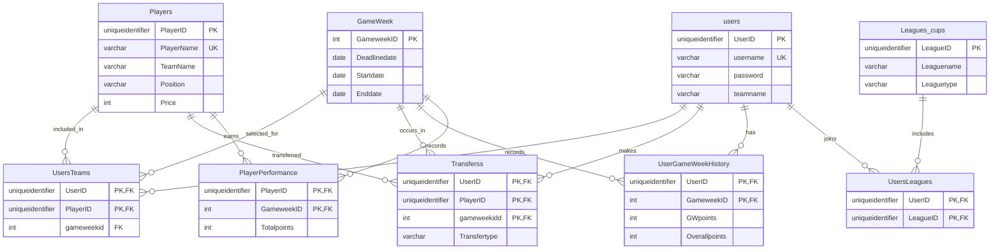

# FPL Database ERD and Relational Mapping

This document summarizes the nine tables and the foreign key relationships declared in `database/fplscript.sql`.

**Key:** `PK` = primary key, `FK` = foreign key, `UQ` = unique constraint. `NULL` columns are nullable.

## Schema notes

- `UsersTeams` stores a gameweek foreign key, but its primary key is only (`UserID`, `PlayerID`). As defined, the same player cannot have multiple squad rows for one user across different gameweeks. Include `gameweekid` in the key if the table should preserve a separate squad per gameweek.
- `Players.TeamName` is text; there is no clubs table or foreign key for it.
- `users.password` is text in this schema. A real application should store a salted password hash instead of a plaintext password.
- `Cleansheets` is represented as `binary(1)`.

## Entity relationship diagram

The diagram below follows the foreign keys declared in the SQL script. Crow's foot (`o{`) means zero or many child rows; each child row refers to exactly one parent row (`||`).

## Relational mapping

### `users`

| Column | SQL type | Constraints |
|---|---|---|
| `UserID` | `uniqueidentifier` | PK, NOT NULL, default `NEWID()` |
| `username` | `varchar(20)` | NOT NULL, UQ |
| `password` | `varchar(max)` | NOT NULL |
| `teamname` | `varchar(20)` | NOT NULL |
| `country` | `varchar(20)` | NULL |
| `Dateofbirth` | `date` | NULL |
| `Gender` | `varchar(20)` | NULL |
| `emailaddress` | `varchar(20)` | NULL, UQ |
| `SquadValue` | `int` | NULL, default `0`, check 0–100 |
| `IntheBank` | `int` | NULL, default `100`, check 0–100 |

### `Players`

| Column | SQL type | Constraints |
|---|---|---|
| `PlayerID` | `uniqueidentifier` | PK, NOT NULL, default `NEWID()` |
| `PlayerName` | `varchar(20)` | NOT NULL, UQ |
| `TeamName` | `varchar(20)` | NOT NULL |
| `Country` | `varchar(20)` | NULL |
| `Position` | `varchar(20)` | NULL |
| `Price` | `int` | NULL |

### `GameWeek`

| Column | SQL type | Constraints |
|---|---|---|
| `GameweekID` | `int` | PK, NOT NULL |
| `Deadlinedate` | `date` | NULL |
| `Startdate` | `date` | NULL |
| `Enddate` | `date` | NULL |

### `PlayerPerformance`

| Column | SQL type | Constraints |
|---|---|---|
| `PlayerID` | `uniqueidentifier` | PK (composite), FK → `Players.PlayerID`, NOT NULL |
| `GameweekID` | `int` | PK (composite), FK → `GameWeek.GameweekID`, NOT NULL |
| `Minutesplayed` | `int` | NULL |
| `Goalsscored` | `int` | NULL |
| `Assists` | `int` | NULL |
| `Cleansheets` | `binary(1)` | NULL |
| `Totalpoints` | `int` | NULL |

**Primary key:** (`PlayerID`, `GameweekID`)

### `UsersTeams`

| Column | SQL type | Constraints |
|---|---|---|
| `UserID` | `uniqueidentifier` | PK (composite), FK → `users.UserID`, NOT NULL |
| `PlayerID` | `uniqueidentifier` | PK (composite), FK → `Players.PlayerID`, NOT NULL |
| `gameweekid` | `int` | FK → `GameWeek.GameweekID`, NOT NULL |

**Primary key:** (`UserID`, `PlayerID`)

### `Transferss`

| Column | SQL type | Constraints |
|---|---|---|
| `UserID` | `uniqueidentifier` | PK (composite), FK → `users.UserID`, NOT NULL |
| `PlayerID` | `uniqueidentifier` | PK (composite), FK → `Players.PlayerID`, NOT NULL |
| `Transferdate` | `date` | NULL |
| `Transfertype` | `varchar(20)` | NULL, check `in` or `out` |
| `gameweekidd` | `int` | PK (composite), FK → `GameWeek.GameweekID`, NOT NULL |

**Primary key:** (`UserID`, `PlayerID`, `gameweekidd`)

### `UserGameWeekHistory`

| Column | SQL type | Constraints |
|---|---|---|
| `UserID` | `uniqueidentifier` | PK (composite), FK → `users.UserID`, NOT NULL |
| `GameweekID` | `int` | PK (composite), FK → `GameWeek.GameweekID`, NOT NULL |
| `GWpoints` | `int` | NULL |
| `Overallpoints` | `int` | NULL |
| `GWRank` | `int` | NULL |
| `OverallRank` | `int` | NULL |

**Primary key:** (`UserID`, `GameweekID`)

### `Leagues_cups`

| Column | SQL type | Constraints |
|---|---|---|
| `LeagueID` | `uniqueidentifier` | PK, NOT NULL, default `NEWID()` |
| `Leaguename` | `varchar(20)` | NOT NULL; indexed |
| `Leaguetype` | `varchar(20)` | NOT NULL, check `public` or `privite` |

### `UsersLeagues`

| Column | SQL type | Constraints |
|---|---|---|
| `UserID` | `uniqueidentifier` | PK (composite), FK → `users.UserID`, NOT NULL |
| `LeagueID` | `uniqueidentifier` | PK (composite), FK → `Leagues_cups.LeagueID`, NOT NULL |

**Primary key:** (`UserID`, `LeagueID`)
